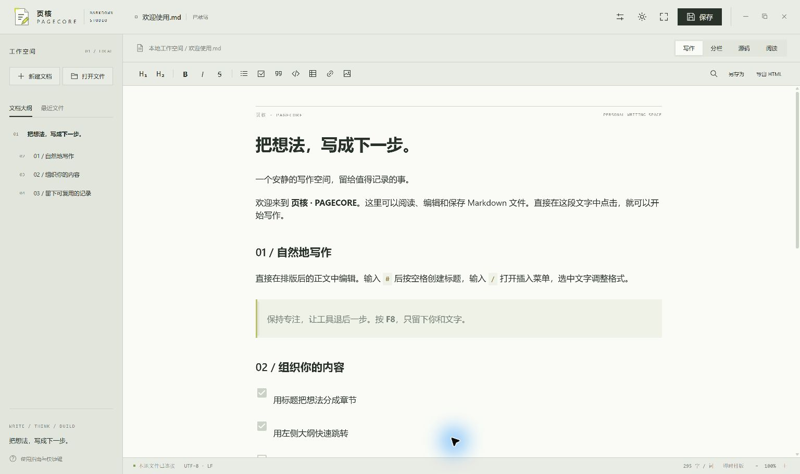
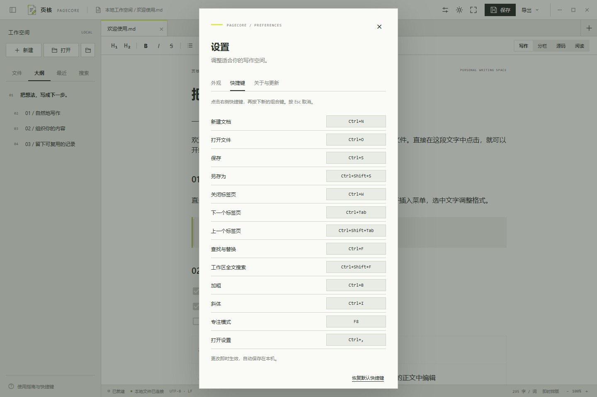

<p align="center"></p>

<h1 align="center">页核 · PAGECORE</h1>
<p align="center">把想法，写成下一步。<br>一款面向 Windows 的本地 Markdown 编辑器。</p>
<p align="center"><a href="https://github.com/GanShuPA/PageCore-Markdown/releases/tag/v1.0.0">下载 Windows 正式版</a> · <a href="docs/USER-GUIDE.md">使用指南</a> · <a href="docs/EMBEDDING.md">嵌入接口</a> · <a href="docs/CHANGELOG.md">版本记录</a></p>



页核把即时排版、Markdown 源码和本地文件操作放在一个安静的写作空间里。界面采用浅色工业线条设计、无边框窗口与少量荧光黄点缀，也可切换深色主题。直接在排版后的正文中编辑，让记录与阅读自然衔接。

**当前版本：v1.0.0 正式版 · Windows x64 · MIT**

打开文件夹管理文档，用全文搜索定位内容；粘贴或拖入图片，退出后恢复标签和阅读位置。多标签页各自保留编辑状态和撤销记录，并提供未保存提示和多文档草稿恢复。

## 下载与启动

1. 前往 [Releases](https://github.com/GanShuPA/PageCore-Markdown/releases/tag/v1.0.0)，下载 **PageCore-v1.0.0-windows-x64.zip**，不要选择仅含源码的 Source code 压缩包。
2. 将整个压缩包解压到可写目录。
3. 双击 **启动页核.cmd**，或运行 `bin/PageCore.exe`。可把 `.md` 文件拖到启动文件上打开。

运行需要 Windows x64、[.NET Framework 4.8](https://dotnet.microsoft.com/download/dotnet-framework/net48) 和 [Microsoft Edge WebView2 Runtime](https://developer.microsoft.com/microsoft-edge/webview2/)。应用不需要安装 Node.js，也不需要启动本地服务器。压缩包是便携版，不是安装程序；当前可执行文件尚未代码签名。

## 能做什么

| 功能               | 说明                                                                                      |
| ------------------ | ----------------------------------------------------------------------------------------- |
| 四种编辑视图       | 写作：直接编辑排版后的正文；分栏：源码与预览并排；源码：精细修改 Markdown；阅读：完整预览 |
| 多标签页           | 新建和打开多个文档，独立撤销、保存状态、视图与滚动位置                                    |
| 文件夹工作区       | 记住上次打开的文件夹、按需展开目录、新建文档与文件夹、重命名文档、刷新文件树              |
| 全文搜索与会话恢复 | 工作区文字搜索、匹配高亮和行号跳转；重启恢复标签、视图、选区与阅读位置                    |
| 日常文档           | 新建、打开、保存、另存为、最近文件、大纲跳转、字数统计                                    |
| 内容排版           | 标题、粗体、斜体、删除线、引用、列表、任务、表格、图片、链接、代码与数学公式              |
| 图片粘贴与拖入     | 粘贴、拖入或选择图片，保存到文档旁的资源文件夹并插入相对路径                              |
| 写作偏好           | 明暗主题、字号、正文行距、专注模式，偏好自动保存在本机                                    |
| 自定义快捷键       | 13 项操作可改键，录入时检查冲突，提示与帮助页同步更新，支持恢复默认                       |
| 自动升级           | 设置中的“关于与更新”支持检查正式版、下载校验、安装重启与失败回滚                          |
| 文档保护           | 未保存确认、原子保存、保存前备份、外部修改检测、异常退出后的草稿恢复                      |
| 文件兼容           | UTF-8 / BOM、UTF-16 LE/BE、GB18030；尽量保留原始编码和换行符                              |
| 导出               | HTML、可编辑 Word 和可设置排版的 PDF；支持内嵌文档目录中的相对路径图片                    |



### 默认快捷键

| 操作               | 快捷键                    |
| ------------------ | ------------------------- |
| 新建 / 打开        | Ctrl+N / Ctrl+O           |
| 保存 / 另存为      | Ctrl+S / Ctrl+Shift+S     |
| 关闭标签页         | Ctrl+W                    |
| 切换标签页         | Ctrl+Tab / Ctrl+Shift+Tab |
| 查找与替换（源码） | Ctrl+F                    |
| 工作区全文搜索     | Ctrl+Shift+F              |
| 加粗 / 斜体        | Ctrl+B / Ctrl+I           |
| 专注模式           | F8                        |
| 打开设置           | Ctrl+,                    |
| 撤销 / 重做        | Ctrl+Z / Ctrl+Shift+Z     |

在 **设置 → 快捷键** 中点击某项组合键，再按新的组合键即可修改。复制、粘贴、撤销等常用快捷键保留给系统与编辑器，不属于可改键列表。

### 工作区搜索与会话恢复

打开文件夹后，点击侧栏“搜索”或按 `Ctrl+Shift+F` 检索文档全文，点击结果在源码模式定位并选中匹配文本。退出再启动可恢复上次打开的文件标签、活动文档、模式和阅读位置；异常退出的未保存内容通过“恢复草稿”找回。

## 数据保存在何处

文档保存在你选择的本地路径。运行目录中的 `.runtime/` 保存最近文件、界面偏好、WebView2 数据、草稿和备份；发布包不包含开发机器的这些数据。

- `.runtime/recovery.json`：未保存草稿；恢复时作为副本打开，不自动覆盖原文件。
- `.runtime/session.json`：标签和阅读位置；已保存文档重新从磁盘读取。
- `.runtime/workspace.json`：上次打开的工作区目录。
- `.runtime/backups/`：保存前备份；目前不自动清理。
- 不内置云同步、账号系统或遥测。桌面版默认启动时向 GitHub 检查正式版本，可在“设置 → 关于与更新”关闭。远程图片仍可能访问图片站点，外部链接由默认浏览器打开。

移动便携版时，如需保留偏好和草稿，请连同 `.runtime/` 一起移动。v1.0.0 起可在“设置 → 关于与更新”下载并安装后续正式版。旧版首次升级需先退出程序，替换程序文件，保留原 `.runtime/`。**恢复草稿不能代替保存文件。**

## 正式版的边界

- 暂不支持云同步和插件系统。会话恢复不包含跨次启动的撤销记录；正常退出时放弃的修改不会恢复。
- 即时排版编辑可能规范化 Markdown 空行、列表等写法；对原文格式敏感时请使用源码模式。
- 大于 500 KB、带 YAML 头部或部分复杂 HTML 的文档默认使用源码模式；单文档和单张插入图片各不超过 10 MB。
- 部分扩展语法与插件尚未支持；当前仅提供 Windows x64 构建。
- 桌面嵌入接口已准备好，当前版本仍为独立应用。

## 从源码构建

开发环境：Windows x64、Node.js 24.15 或以上的 24.x、pnpm 11.25.0、.NET Framework 4.8。WebView2 SDK 1.0.3800.47 的必要 DLL 与许可已随仓库提供；运行应用仍需安装 WebView2 Runtime。

```powershell
pnpm install --frozen-lockfile
pnpm check
pnpm build
powershell -NoProfile -ExecutionPolicy Bypass -File .\scripts\build-native.ps1
powershell -NoProfile -ExecutionPolicy Bypass -File .\scripts\package-release.ps1
powershell -NoProfile -ExecutionPolicy Bypass -File .\scripts\verify-release.ps1
```

打包文件统一输出到 `release/packages/`：`PageCore-v1.0.0-windows-x64.zip` 和 `SHA256SUMS.txt`。验证脚本检查压缩包内容，并从新解压目录运行原生文件会话自检。GitHub Actions 在推送和 PR 时执行测试、构建及打包验证；推送版本标签时另行建立正式 Release。

图标生成脚本需要 `sharp`，可将 `FIELD_SHARP_PATH` 指向本机模块目录后执行 `node scripts/build-icon.cjs`。正常构建直接使用仓库内已生成的 ICO，不需要图标生成依赖。

| 目录                | 内容                                                       |
| ------------------- | ---------------------------------------------------------- |
| `src/`              | HTML 入口、编辑器、排版渲染、偏好与快捷键                  |
| `scripts/`          | 前端和原生构建、图标生成、检查、打包及验证脚本             |
| `.config/`          | ESLint、Prettier、CSharpier、Playwright 和 PowerShell 配置 |
| `release/packages/` | 生成的安装包与校验文件                                     |
| `native/`           | WinForms + WebView2 宿主、本地文件会话与窗口控制           |
| `assets/`           | SVG 原图与 Windows 多尺寸图标                              |
| `tests/`            | Markdown 渲染、内容过滤及快捷键回归测试                    |
| `docs/`             | 使用指南、截图、嵌入协议、发布说明                         |
| `vendor/webview2/`  | 固定版本 SDK 组件及第三方许可                              |

详细的模块边界、格式规则和完整检查命令见 [开发规范](docs/DEVELOPMENT.md)。

## 许可与致谢

项目代码按 [MIT License](LICENSE) 发布。编辑器使用 Milkdown / Crepe、CodeMirror、Marked、DOMPurify、KaTeX 和 Microsoft WebView2 等组件，各组件保留自身许可。构建在 `dist/licenses/` 生成 `THIRD-PARTY.json`、`THIRD-PARTY-LICENSES.txt`，并复制 WebView2 许可；发布包保留该目录。

问题反馈请前往 [Issues](https://github.com/GanShuPA/PageCore-Markdown/issues)，附上版本、复现步骤和经过脱敏的示例文档。
